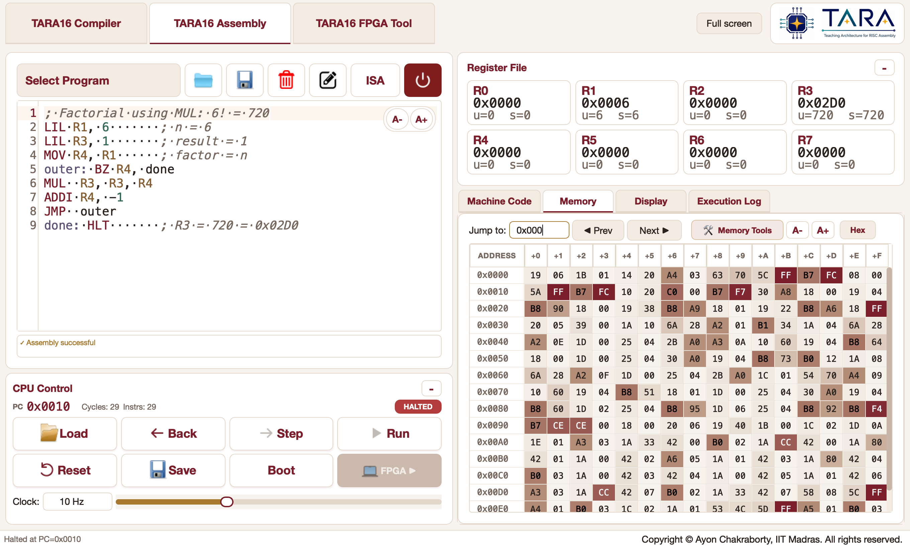

# TARA Studio

TARA16 (Teaching Architecture for RISC Assembly) is a compact 16-bit processor
architecture designed for teaching assembly and computer organization.
`taracpu` is the installable Python package that contains the TARA16 software
tools: the assembler, C compiler, emulator,
examples, and FPGA interface.

TARA Studio is the desktop emulator and development environment included with
`taracpu`. It lets you write TARA16 assembly or C programs, execute them one
instruction at a time, and inspect registers, memory, machine code, execution
history, and the 64 x 64 pixel display.

## Install and run

The hassle-free setup is:

```bash
python -m pip install --upgrade taracpu
taracpu
```

TARA Studio requires Python 3.9 or later. For a guided introduction, controls,
examples, and the architecture reference, see the
[TARA Studio manual](https://cse.iitm.ac.in/~ayon/courses/CS2300/taramanual/tarastudio/).



## TARA16 instruction set

TARA16 uses 16-bit fixed-width instructions with a 5-bit opcode, eight 16-bit
registers (`R0`-`R7`), and 2 KiB of byte-addressed memory. Each instruction
occupies two bytes. `R6` is the link register used by `CALL` and `RET`; `R7` is
the stack pointer used by `PUSH` and `POP`.

| Group | Opcode | Instruction | Syntax | Effect |
| --- | ---: | --- | --- | --- |
| System | 0 | `NOP` | `NOP` | No operation |
| System | 1 | `HLT` | `HLT` | Halt execution |
| Move / immediate | 2 | `MOV` | `MOV Rd, Rs` | `Rd = Rs` |
| Move / immediate | 3 | `LIL` | `LIL Rd, imm8` | Load `imm8` into the low byte of `Rd` and clear its high byte |
| Move / immediate | 4 | `LIH` | `LIH Rd, imm8` | Load `imm8` into the high byte of `Rd` and preserve its low byte |
| Memory | 5 | `LDW` | `LDW Rd, off5(Rb)` | Load a 16-bit word from memory |
| Memory | 6 | `STW` | `STW Rs, off5(Rb)` | Store a 16-bit word in memory |
| Memory | 7 | `LDB` | `LDB Rd, off5(Rb)` | Load a byte from memory |
| Memory | 8 | `STB` | `STB Rs, off5(Rb)` | Store the low byte of `Rs` in memory |
| Arithmetic | 9 | `ADD` | `ADD Rd, Ra, Rb` | `Rd = Ra + Rb` |
| Arithmetic | 10 | `SUB` | `SUB Rd, Ra, Rb` | `Rd = Ra - Rb` |
| Arithmetic | 11 | `ADDI` | `ADDI Rd, imm8` | Add a sign-extended immediate to `Rd` |
| Arithmetic | 12 | `MUL` | `MUL Rd, Ra, Rb` | `Rd = Ra * Rb` |
| Logic | 13 | `AND` | `AND Rd, Ra, Rb` | `Rd = Ra & Rb` |
| Logic | 14 | `OR` | `OR Rd, Ra, Rb` | `Rd = Ra \| Rb` |
| Logic | 15 | `XOR` | `XOR Rd, Ra, Rb` | `Rd = Ra ^ Rb` |
| Logic | 16 | `NOT` | `NOT Rd, Rs` | `Rd =` bitwise NOT of `Rs` |
| Shift / compare | 17 | `SHL` | `SHL Rd, shamt` | Shift `Rd` left |
| Shift / compare | 18 | `SHR` | `SHR Rd, shamt` | Shift `Rd` right logically |
| Shift / compare | 19 | `SLT` | `SLT Rd, Ra, Rb` | Set `Rd` to 1 when signed `Ra < Rb`, otherwise 0 |
| Control flow | 20 | `BZ` | `BZ Rt, label` | Branch when `Rt == 0` |
| Control flow | 21 | `BN` | `BN Rt, label` | Branch when signed `Rt < 0` |
| Control flow | 22 | `JMP` | `JMP label` | PC-relative jump |
| Control flow | 23 | `CALL` | `CALL label` | Save the return PC in `R6`, then jump |
| Control flow | 24 | `RET` | `RET` | Return to the address in `R6` |
| Stack | 25 | `PUSH` | `PUSH Rs` | Decrement `R7` by 2 and store `Rs` at the stack top |
| Stack | 26 | `POP` | `POP Rd` | Load the stack top into `Rd`, then increment `R7` by 2 |

The same reference is available inside TARA Studio from the **ISA** button.

## What TARA Studio provides

- **TARA16 C compiler:** compile the bundled 16-bit C dialect, inspect the
  generated assembly, and send it directly to the emulator.
- **Assembly emulator:** assemble, step, run, and rewind programs while
  inspecting the complete processor state.
- **FPGA interface:** load programs into an already configured TARA16 FPGA and
  inspect its memory, with an emulator-memory target when no board is connected.

The browser-based [TARA16 emulator](https://cse.iitm.ac.in/~ayon/courses/CS2300/taracpu/)
is also available when you do not want to install the desktop application.

## FPGA support

This repository includes a prebuilt TARA16 FPGA bitfile for the Digilent
Basys 3. TARA Studio selects the bundled image by default and can configure the
board through [openFPGALoader](https://trabucayre.github.io/openFPGALoader/), or
connect to a board on which the bitfile is already loaded. FPGA support has
been tested only with the Basys 3.

The TARA16 Verilog source is not included here; a separate Verilog repository
provides the softcore CPU hardware source. The compiler and emulator in this
repository work without FPGA hardware.

## Work with the source

Clone this repository if you want to study the implementation, modify the UI,
or develop TARA Studio itself:

```bash
git clone https://github.com/ayonsense/tara16-studio.git
cd tara16-studio
python -m venv .venv
source .venv/bin/activate
python -m pip install --upgrade pip
python -m pip install -e .
taracpu
```

On Windows, activate the environment with `.venv\Scripts\activate` instead.
The `taracpu` command and `python -m taracpu` start the same application.

The repository intentionally contains only what is needed to build and run the
application:

```text
pyproject.toml       package metadata and dependencies
taracpu/             command-line launcher package
src/compiler/        TARA16 C compiler and C examples
src/assembler/       TARA16 assembler
src/simulation/      processor model used by the emulator
src/ui/              desktop user interface and FPGA tools
src/examples/        bundled assembly examples
src/assets/          application icons and branding used at runtime
src/usage/           local counters and anonymous usage reporting
```

Build output, upload scripts, extracted old releases, local settings, IDE files,
and publishing credentials are deliberately excluded.

## Usage reporting

TARA Studio records anonymous product-usage counts to help improve the teaching
tools. It does not send source code, file paths, or program contents. To disable
network reporting for a session:

```bash
TARA_ANALYTICS_ENABLED=0 taracpu
```

## License

TARA Studio is developed by Ayon Chakraborty, IIT Madras, and is licensed under
GPL-3.0-or-later. The bundled compiler includes chibicc-derived components; its
upstream license and attribution are retained under `src/compiler/`.
